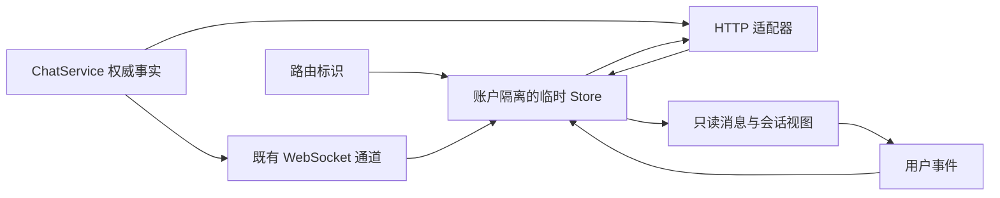

# Twitter UI 私信

## 页面与入口

登录用户通过侧栏、移动底栏或其他本地用户主页中关注按钮旁的私信按钮进入。自己的主页、远程用户和聊天被角色禁用的账户不显示该主页入口。主页按钮用于打开会话；是否可以发送由服务端联系能力接口确认，接收范围不允许时仍可阅读已有消息并查看限制原因。

| 路由 | 展示 |
| --- | --- |
| `/chat` | 收件箱；宽工作区同时显示未选择会话空态 |
| `/chat/user/:userId` | 一对一本地私信 |
| `/chat/room/:roomId` | 群聊；受邀用户可查看邀请并加入 |
| `/chat/messages/:messageId` | 经服务端授权解析的消息深链及历史定位 |

路由只序列化标识。`pages/chat/entry.vue` 按既有 UI 上下文挂载 Twitter 工作区或存量 Misskey 页面，两套页面不会同时查询或标读。原生 UI 的聊天路由、读取即标读以及共享基础组件继续服务存量用户。

## 布局与交互

私信采用有界工作区，由收件箱和消息列表各自滚动。Shell 不显示推荐右栏和发帖悬浮按钮；导航、外层宽度、页头和筛选标签消费当前 Twitter UI 的共享规则。普通内容页继续使用原主滚动宿主，往返私信不改变时间线的位置恢复规则。

私信与普通页面的 Shell 外框由同步路由展示策略决定，不等待页面模块或 `definePage` 元信息交付。普通页返回私信时，当前账户内已建立的推荐右栏隐藏保留；首次直接进入私信不为隐藏右栏启动查询。页面的 [路由内容轻淡入](./route-entry-motion.md) 只操作当前真实 DOM 的透明度，不重建聊天页面或增加阅读租约，也不延迟发送、查询或显式标读。

| 视口范围 | 主导航与消息工作区 |
| --- | --- |
| `≥1280px` | `275px` 完整侧栏；主列与右栏的既有空间合并为最多 `950px` 的工作区，其中收件箱为 `350px`，会话区域约 `600px` |
| `501–1279px` | `72px` 图标侧栏；工作区最多 `600px`，依路由显示收件箱或会话单栏 |
| 移动布局 | 工作区占可用宽度；收件箱保留全局底栏，会话隐藏底栏；所有私信页隐藏发帖 FAB |

宽度均从既有权威 Token 派生：完整导航使用 `--twitter-sidebar-width`，图标导航使用 `--twitter-sidebar-icon-width`；宽工作区为 `calc(var(--twitter-main-width) + var(--twitter-right-rail-width))`，收件箱使用 `--twitter-right-rail-width`，紧凑单栏使用 `--twitter-main-width`。`950px` 是当前 `600px + 350px` 的结果，不另建固定工作区宽度常量；边框占位使会话可用内宽略小于 `600px`。不足上限时按实际可用空间收缩，不制造横向页面滚动。移动布局的既有设备判断继续生效。

分栏仍以工作区**实际容器宽度**达到 `918px` 为条件，不把它改成视口断点，也不在组件复制一套全站断点。页头高度复用 `--twitter-header-height`（当前 `50px`），页头标题复用 `--twitter-font-size-title`（当前 `18px`）；空态大标题保持其独立的展示语义。收件箱的全部／私信／群聊筛选使用 `TwitterTabIndicator` 共享指示条，保留等分命中区、选中状态和既有筛选动作，不另建胶囊式选中样式或动画计时器。

普通字体、颜色、边框、触控和间距消费既有 Nitter 语义 Token。Nitter 没有聊天布局，所有者提供的 X 采集资源 `pin-page-rweb-Bzw7XJ9G.js`、`xchat-init-Dx5N5UY6.js` 用于补充独立会话工作区和空态表现；空态圆形为 `96px`、图标为 `48px`。归档不作为完整 X 产品协议，也不覆盖共享 Shell 的权威尺度。

收件箱、消息列表和编辑器继续分别承担其原有滚动或底部布局责任。编辑器消费可视视口几何与 safe-area，软键盘出现时保持发送控件可达；布局变化不获取额外会话租约、不触发后台标读，也不创建另一份会话状态。

收件箱支持全部／私信／群聊筛选、服务端会话搜索和分页。消息支持历史分页、会话内搜索和跳转、文本、单个已有网盘附件、表情反应、本人消息删除和复制链接。编辑器遵循既有发送键偏好；中文输入法组合输入不触发发送。发送失败保留草稿；传输结果不确定时提示核对历史，只有用户确认后才能再次发送，不自动重试。

群聊支持创建、编辑名称和说明、邀请本地用户、接受或忽略邀请、成员展示、静音、退出，以及拥有者删除。已有服务端规则决定成员资格、邀请和发送权限；群详情不通过邀请字段推断成员身份。

## 数据与状态

`ui/twitter/messages/domain/index.ts` 从生成的 `misskey-js` 权威实体和接口派生只读类型，仅另行定义客户端查询及命令生命周期。`adapters/index.ts` 封装账户认证、请求和冻结映射；`store/index.ts` 是业务状态唯一可写所有者，`components/` 呈现业务控件，`pages/MessagesPage.vue` 协调路由工作区。外部通过模块顶层 `index.ts` 消费。实现沿用 Misskey 的 Vue 响应式基础设施，不引入另一套状态框架。

消息正文和草稿仅存在账户隔离内存，草稿最多保留 30 个会话。换号或登出清空状态，请求以账户和会话代次拒绝迟到结果。HTTP 与流式回执按消息 ID 合并，删除墓碑阻止迟到历史重新加入已删除消息。页面停用时释放租约；重连和恢复可见时重新对账，不另建 WebSocket，不重复播放消息声音。

运行中的账户策略更新消费现有 `meUpdated` 事件；撤销阅读能力后清除正文、搜索和成员视图。现有角色分配操作本身不发布该事件，角色分配的全站自动推送不属于本模块提供的能力。真实测试通过角色变更后执行 `i/update` 产生权威账户更新，验证活动会话能够消费该策略，不把手动刷新或伪造推送当作证明。

未读点来源于账户接口 `/api/i` 的权威字段，不从会话分页推算。`main.chatUpdated`、连接恢复、页面恢复可见、发送及显式标读使账户快照失效。同步通过既有账户更新函数发布，并拒绝旧账户、旧令牌和在失效之后返回的快照。

读取消息历史使用 `markAsRead: false`。只有活动、可见且位于消息底部附近的会话，才提交实际装载消息 ID 至 `chat/conversations/read`。后台同步、搜索、未选择会话和历史上拉不会清除未观察到的新消息。界面不将自己的未读状态解释成对方已读回执。

## 服务端契约

| 接口或字段 | 职责 |
| --- | --- |
| `chat/contacts/show` | 服务端判定阅读／发送能力及结构化拒绝原因；与实际发送共用判断 |
| `chat/conversations/list` | 先按会话聚合最新消息，再按不透明游标分页；包含没有消息的所属群聊 |
| `chat/conversations/read` | 验证账户、会话和已观察消息归属，原子标读该位置，保留并发新消息 |
| `chat/messages/{user,room}-timeline` 的 `markAsRead` | 默认 `true` 服务存量原生调用，新工作区显式传 `false` |
| `chat/messages/search` 的 `untilId` | 既有会话范围内的历史搜索游标 |
| `ChatRoom.isMember` | 服务端返回当前阅读者的真实成员资格，邀请及管理权限不替代此字段 |
| `main.chatUpdated` | 账户级聊天事实失效事件；客户端重新查询，不把事件当完整状态 |

授权、拉黑、角色只读／禁用、接收范围、群成员资格、文本长度和附件归属均由 ChatService 校验。可预期拒绝返回结构化 4xx，不再把接收范围限制显示成服务器内部错误。显式标读通过 Redis 原子操作与读位置共同防止并发发送、迟到标记和全部已读之间互相覆盖。此实现不变更数据库实体，不新增数据库 migration。

## 验证与能力边界

后端真实集成测试：`packages/backend/test/e2e/chat.ts`。前端真实浏览器回归：`packages/frontend/test/e2e/twitter-messages.spec.ts`。适配器单元测试仅验证协议映射、取消和账户快照边界，不作为业务集成证明。

测试实例必须使用独立 PostgreSQL、Redis 及运行目录；配置编译会写入仓库根目录的 `built/.config.json`，不能在共享开发服务运行时用该文件承载测试配置。具体运行结果和截图以本次交付记录为准，不预先声明浏览器或平台已经通过。

当前私信只支持实例内本地用户，群聊沿用已有 Misskey 能力。不提供远程 Chat 投递、端到端加密、语音／视频通话、正在输入、对方已读回执、消息请求箱或归档。这些能力没有被界面空壳模拟。正式全站视觉基线仍属于后置 P-19；专项固定视口截图与 diff 用于本次审阅，移动真机软键盘和 Safari 需要对应设备核查。

专项结果与视觉材料见 [messages-validation.md](./messages-validation.md)。接入与数据所有权决策见 [ADR-0033](./adr/0033-twitter-messages-workspace.md)，共享 Shell 尺度与导航决策见 [ADR-0034](./adr/0034-messages-shared-shell.md)。
